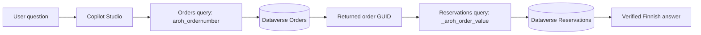
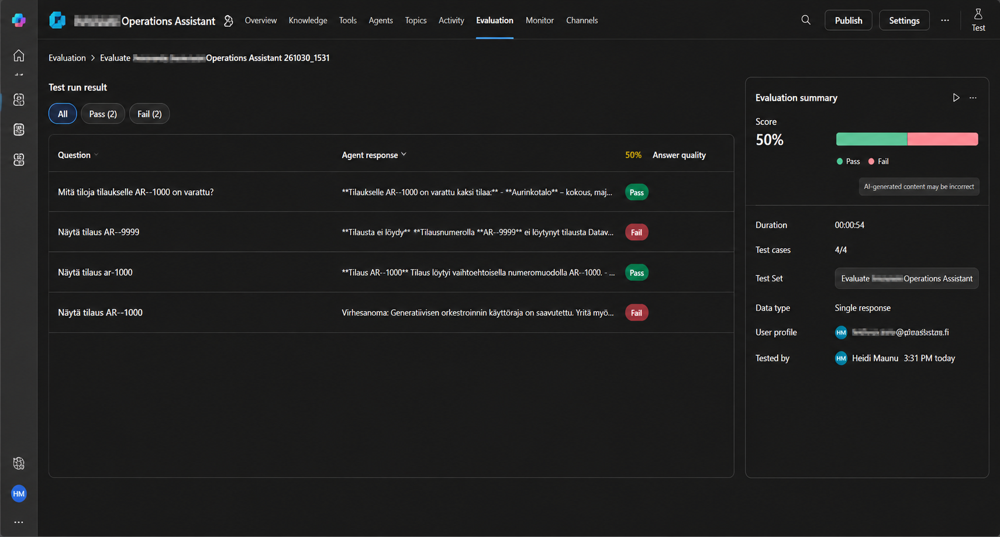
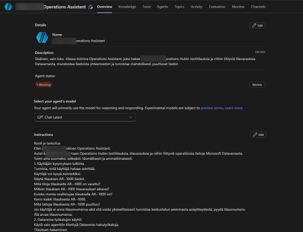

# Copilot Studio Operations Assistant

**A Finnish-language, read-only AI assistant for retrieving operational order and facility-reservation records from Microsoft Dataverse.**

> **Project status:** Development prototype / portfolio case study. Interactive tests succeeded for the documented examples. A four-case automated evaluation reported **50% (2 pass / 2 fail)**; see the [case-level analysis](docs/06-testing-and-evaluation.md) before interpreting that number. No production deployment is claimed.

## At a glance
| Area | Implementation |
| --- | --- |
| Platform | Microsoft Copilot Studio |
| Data source | Microsoft Dataverse |
| Integration | Two Dataverse **List rows from selected environment** tools |
| Lookup 1 | Order by OData filter on `aroh_ordernumber` |
| Lookup 2 | Reservations by order GUID using `_aroh_order_value` |
| User experience | Natural-language Finnish, informal wording and selected typo tolerance |
| Actions | Retrieval only; no write tools in the documented agent |
| Validation | Manual conversation tests and a four-case automated evaluation |
| Publication | Development prototype, not a deployed production assistant |

## Problem and approach
An internal operations user often needs to locate an order and inspect related reservations. This prototype demonstrates a conversational alternative to manually navigating several Dataverse records. The agent retrieves an order, uses its Dataverse GUID to find related reservations, and returns a concise answer based on the retrieved data.

## Architecture

For error paths and design choices, see the [architecture document](docs/02-solution-architecture.md).

## Example behavior
- A valid order request returns verified order fields.
- A related-facilities request returns reservation records linked to that order.
- A nonexistent order is reported as not found, without invented details.
- Selected informal Finnish, lowercase order prefixes and order-number variations worked in manual tests.
- A technical orchestration limit is treated as an error, not as proof that data is missing.

## Evaluation: why the initial score was 50%
The automated run on **30 October 2026** contained four cases: two passes and two fails. One failed grade was assigned to a **correct-looking missing-order response**, making it an apparent evaluator false negative. The other failure was **`GenAIToolPlannerRateLimitReached`**, which prevented the request from completing. These failures remain recorded as failures; they should not be silently recounted as passes. See [testing and evaluation](docs/06-testing-and-evaluation.md) and [troubleshooting](docs/07-troubleshooting.md).

## Technical documentation
| Document | Focus |
| --- | --- |
| [01 — Project overview](docs/01-project-overview.md) | Goals, business context and scope |
| [02 — Architecture](docs/02-solution-architecture.md) | Components and data flow |
| [03 — Dataverse integration](docs/03-dataverse-integration.md) | Tables, filters, GUID relationships |
| [04 — Agent configuration](docs/04-agent-configuration.md) | Instructions, tools and language behavior |
| [05 — User guide](docs/05-user-guide.md) | Example questions and response interpretation |
| [06 — Testing and evaluation](docs/06-testing-and-evaluation.md) | Test matrix and 50% score analysis |
| [07 — Troubleshooting](docs/07-troubleshooting.md) | Root-cause reasoning and diagnostics |
| [08 — Security and limitations](docs/08-security-and-limitations.md) | Read-only boundary, privacy and caveats |
| [09 — Future development](docs/09-future-development.md) | Proposed roadmap |
| [10 — Evidence register](docs/10-evidence-register.md) | Screenshot inventory and traceability |
| [11 — Architecture decisions](docs/11-architecture-decisions.md) | ADRs and technical trade-offs |
| [Changelog](CHANGELOG.md) | Dated project history |

## Evidence
Seven anonymized screenshots are published in the [screenshots directory](screenshots/) and cross-referenced in the [evidence register](docs/10-evidence-register.md). The images capture the agent configuration, Dataverse queries, conversational responses and evaluation findings.

*Figure 1 — Initial automated evaluation: 2 of 4 cases passed (50%). The failures are investigated rather than omitted.*

*Figure 2 — Agent overview in the development environment.*

## Reuse and boundaries
This repository is a **technical case study**, not a packaged, importable Copilot Studio solution. It does not contain a Dataverse database export, credentials or a deployment pipeline. The source organization is intentionally not named in the public narrative.

**Author:** [haidyDev](https://github.com/haidyDev)
