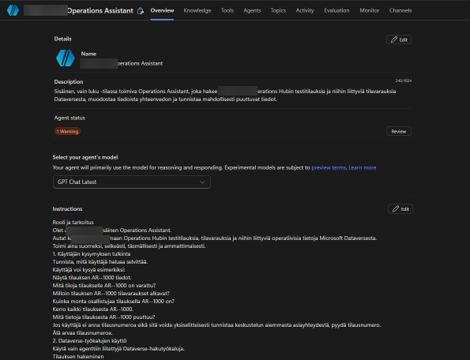
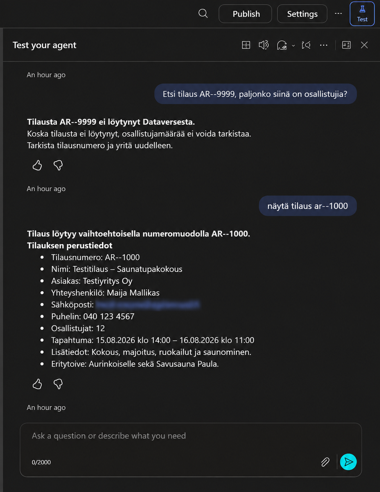

# 04 — Agent configuration

## Platform and mode
The prototype was authored in Microsoft Copilot Studio. The captured Overview shows the model selector set to **GPT Chat Latest** after an earlier model-retirement warning. Model names and availability can change with the service.

## Instruction strategy
The agent was instructed to:
1. Act as an internal operations assistant and answer in Finnish.
2. Recognize requests for order details, participant counts, dates and facilities.
3. Use the configured Dataverse retrieval tools.
4. Search Orders using the logical field `aroh_ordernumber`.
5. Retrieve Reservations using the returned order GUID and `_aroh_order_value`.
6. Distinguish verified values from unavailable or uncertain information.
7. Never fabricate records or treat free-text mentions as proof of a reservation.
8. Handle common typos, lowercase prefixes, informal Finnish and follow-up questions in context.
9. Avoid changes to records and avoid triggering operational actions.

## Tool setup
Both enabled tools use the Dataverse connector. Each selects the environment and table with configured values, while the OData filter is populated dynamically by the agent. The user-visible display name and description of the filter instruct the model how to construct it.

## Accessibility-oriented language handling
The prompt emphasizes short, clear Finnish responses, flexible interpretation of colloquial language and minimal clarification requests. This is a **language-usability design measure**, not evidence of a formal accessibility assessment.

## Example requests
```text
Näytä tilaus AR--1000
mitö tiloja on varattu ar--1000
paljo osallistujii siin on?
Entä tilaus AR--9999, paljonko siinä on osallistujia?
```

## Read-only implementation note
The agent's natural-language instructions say not to modify data. The observed tools are read operations, which is the more important technical constraint. Effective access still depends on the connected Dataverse identity, permissions, environment settings and future tool additions.

## Configuration evidence



*Figure 1 — Copilot Studio agent overview captured during development.*



*Figure 2 — Test conversation demonstrating the agent's Finnish-language responses.*
