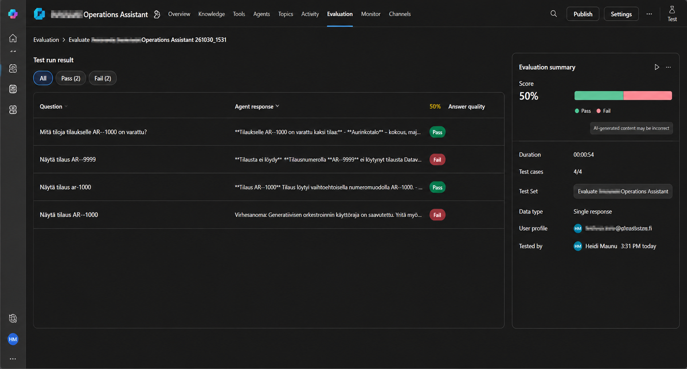
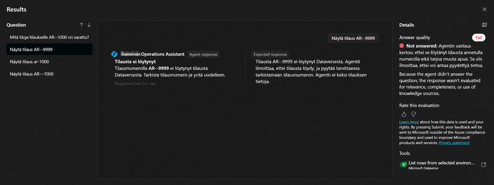
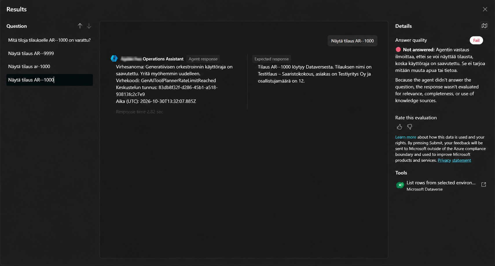
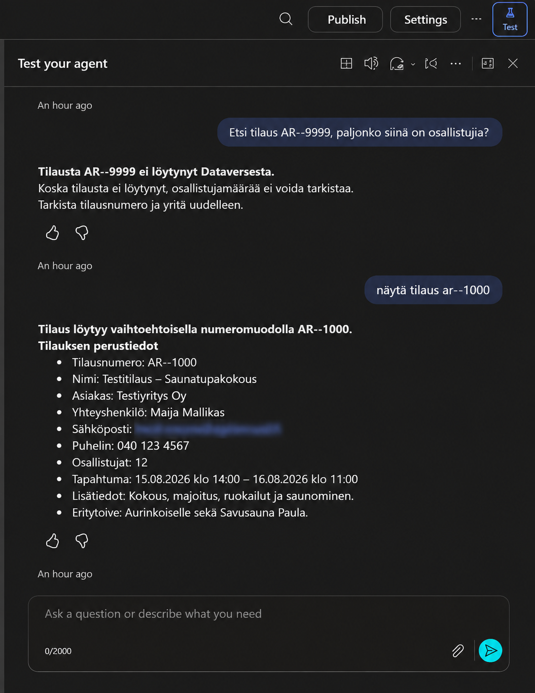

# 06 — Testing and evaluation

## Test approach
Two kinds of testing were performed: interactive tests in Copilot Studio's **Test your agent** pane, and one automated **Evaluation** run with four single-response cases.

## Manual observations
| Scenario | Observation |
| --- | --- |
| Valid order lookup | Order details returned |
| Related facility lookup | Two linked facilities returned for the sample order |
| Missing order | Agent reported no record found |
| Typo / colloquial Finnish | Selected examples understood |
| Lowercase order prefix | Selected example understood |
| Follow-up without repeating number | Participant-count answer returned using conversation context |
| Alternate single-hyphen number | A test found the canonical two-hyphen order |

These observations establish behavior for the tested examples only, not comprehensive robustness.

## Automated evaluation — 30 October 2026
**Test type:** Single response. **Cases:** 4. **Duration shown:** 00:00:54. **Reported score:** **50% (2 pass, 2 fail)**.

| Case | Observed result | Reported result | Analysis |
| --- | --- | --- | --- |
| Related facilities for existing order | Returned facilities | Pass | Positive retrieval evidence |
| Missing order `AR--9999` | Explicitly said no matching order existed and suggested checking the number | Fail | Apparent **false negative**: output aligns with the stated expected response, but the evaluation judged it 'Not answered' |
| Lowercase / alternate-hyphen order request | Found canonical order and summarized details | Pass | Positive natural-language tolerance evidence |
| Existing order lookup | Error `GenAIToolPlannerRateLimitReached` | Fail | **Platform orchestration rate limit**, not a demonstrated incorrect database answer |

### Why 50% needs interpretation
The score is the automated evaluator's result for this four-case run, **not** a statistically meaningful measure of overall agent accuracy. One failed grade conflicts with the visible response and expected-response text. The other failed case never completed because the orchestration limit was reached. The two passed cases demonstrate successful retrieval under the conditions of that run.

### Evidence-based conclusion
The run shows promising functional behavior **and** two distinct quality risks:
1. Automated evaluation may misclassify an appropriate negative answer.
2. Runtime quotas can interrupt an otherwise valid query.

Neither should be hidden or relabeled as a pass. Both are recorded as **reported failures**, with separate root-cause interpretations.

## Recommended follow-up
- Re-run the same four cases when orchestration capacity is available.
- Review the evaluator's grading criteria for 'not found' answers.
- Add repeated runs and multi-turn test cases.
- Test ambiguous order numbers and malformed inputs.
- Track completion rate separately from content accuracy and evaluator agreement.
- Preserve test-run metadata and screenshots for auditability.

## Reproducibility limits
The repository documents visible configuration and screenshots, not a complete exported agent package or an automated CI test harness. Service quotas, model versions, credentials and data state may affect reruns.

## Screenshot evidence

*Figure 1 — Initial evaluation overview (2 pass, 2 fail, 4 total cases).*

*Figure 2 — The missing-order response and evaluator judgment, illustrating an apparent grading false negative.*

*Figure 3 — Service-side orchestration rate limit (`GenAIToolPlannerRateLimitReached`) during evaluation.*

*Figure 4 — Interactive test conversation used as complementary qualitative evidence.*
